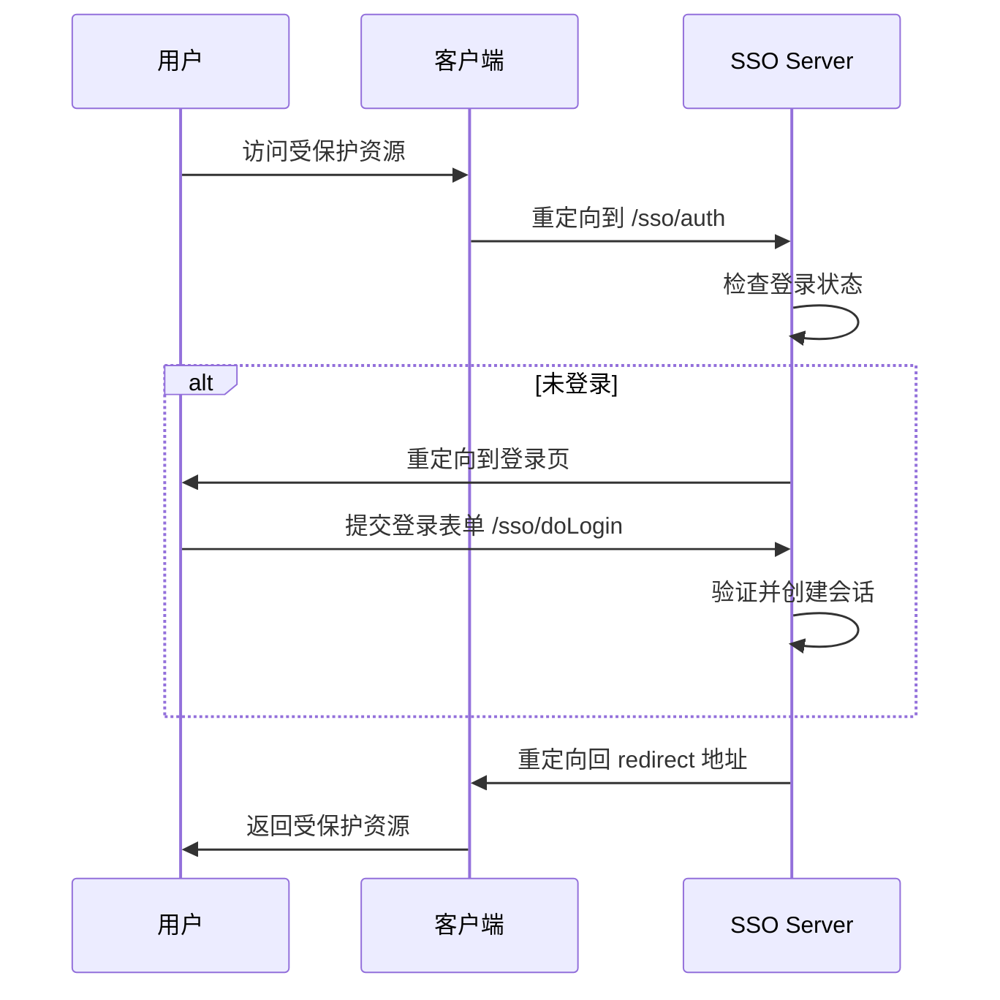
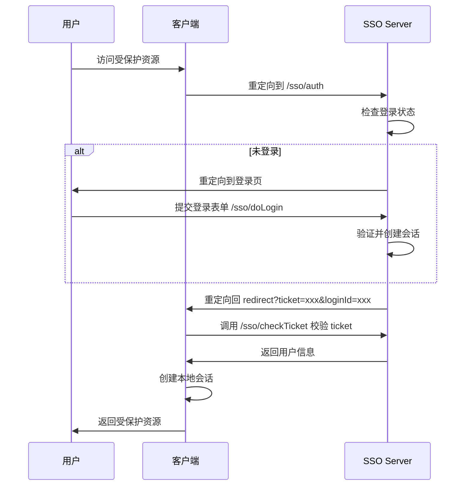

# JDEC Platform SSO 单点登录对接文档

## 概述

JDEC Platform 提供基于 Sa-Token 的 SSO 单点登录服务，支持第三方系统通过标准 SSO 协议接入统一认证中心。

**版本**: v1.0
**基础路径**: `http://{host}:{port}/api/config/sso`
**认证方式**: Sa-Token SSO (支持模式一、模式二、模式三)

---

## 一、SSO 接入模式说明

### 模式一：简单模式 (Simple Mode)
- **特点**: 前后端同域，共享 Cookie
- **适用场景**: 客户端与认证中心在同一主域名下
- **参数**: `mode=simple`

### 模式二：URL 重定向模式
- **特点**: 通过 URL 参数传递 ticket
- **适用场景**: 跨域场景，客户端通过 ticket 换取用户信息
- **参数**: `mode` 不传或传其他值

### 模式三：Http 请求模式
- **特点**: 客户端通过 Http 请求校验 ticket
- **适用场景**: 需要更高安全性的跨域场景

---

## 二、核心接口

### 2.1 SSO 统一请求处理

**接口地址**: `POST/GET /api/config/sso/**`

**说明**: 该接口是 Sa-Token SSO 的统一入口，处理所有 SSO 相关请求。

#### 子路径说明

| 子路径 | 方法 | 说明 |
|--------|------|------|
| `/api/config/sso/auth` | GET | 单点登录授权地址（客户端重定向到此） |
| `/api/config/sso/doLogin` | POST | 账号密码登录接口 |
| `/api/config/sso/signout` | GET | 单点注销地址（需开启 SLO） |
| `/api/config/sso/checkTicket` | GET | 校验 ticket 有效性（模式二/三） |

---

### 2.2 账号密码登录

**接口地址**: `POST /api/config/sso/doLogin`

**请求参数**:

| 参数名 | 类型 | 必填 | 说明 |
|--------|------|------|------|
| name | String | 是 | 用户手机号 |
| pwd | String | 是 | 验证码（或万能密码 1024110） |
| client | String | 是 | 应用标识（projectNo） |

**请求示例**:
```http
POST /api/config/sso/doLogin
Content-Type: application/x-www-form-urlencoded

name=13800138000&pwd=123456&client=SYSTEM
```

**响应示例**:
```json
{
  "code": 200,
  "msg": "登录成功",
  "data": {
    "userId": "1001",
    "username": "张三",
    "token": "eyJhbGciOiJIUzI1NiIsInR5cCI6IkpXVCJ9..."
  }
}
```

**业务逻辑**:
1. 验证用户手机号是否存在
2. 检查用户是否有该应用（projectNo）的访问权限
3. 校验验证码（支持万能密码 `1024110` 用于测试）
4. 登录成功后返回 token 和用户信息

**错误码**:
- `用户不存在`: 手机号未注册
- `用户无此应用使用权限`: 用户未分配该应用角色
- `验证码已过期，请重新获取`: Redis 中验证码已失效
- `验证码错误，请重新输入`: 验证码不匹配

---

### 2.3 获取重定向 URL

**接口地址**: `GET /api/config/sso/getRedirectUrl`

**请求参数**:

| 参数名 | 类型 | 必填 | 说明 |
|--------|------|------|------|
| client | String | 是 | 应用标识（projectNo） |
| redirect | String | 是 | 客户端回调地址（URL 编码） |
| mode | String | 否 | SSO 模式（simple/其他） |

**请求示例**:
```http
GET /api/config/sso/getRedirectUrl?client=SYSTEM&redirect=http%3A%2F%2Fclient.example.com%2Fcallback&mode=simple
```

**响应示例**:

**未登录状态**:
```json
{
  "code": 200,
  "msg": "success",
  "data": ""
}
```

**已登录状态（模式一）**:
```json
{
  "code": 200,
  "msg": "success",
  "data": "http://client.example.com/callback"
}
```

**已登录状态（模式二/三）**:
```json
{
  "code": 200,
  "msg": "success",
  "data": "http://client.example.com/callback?ticket=ST-1234567890&loginId=1001"
}
```

**说明**:
- 未登录时返回空字符串，客户端应引导用户登录
- 模式一直接返回原始 redirect 地址
- 模式二/三返回携带 ticket 和 loginId 的回调地址

---

### 2.4 检查登录状态

**接口地址**: `GET /api/config/sso/isLogin`

**请求参数**: 无（通过 Cookie 或 Header 携带 token）

**响应示例**:
```json
{
  "code": 200,
  "msg": "success",
  "data": true
}
```

**说明**:
- `true`: 已登录
- `false`: 未登录

---

### 2.5 单点登录授权（前端重定向入口）

**接口地址**: `GET /api/config/sso/auth`

**请求参数**:

| 参数名 | 类型 | 必填 | 说明 |
|--------|------|------|------|
| redirect | String | 是 | 客户端回调地址（URL 编码） |
| client | String | 是 | 应用标识（projectNo） |
| mode | String | 否 | SSO 模式 |

**流程说明**:

1. **未登录用户**: 自动重定向到前端登录页
   ```
   重定向到: {sso.login-page-url}?projectNo={client}&redirect={encodedRedirect}
   ```

2. **已登录用户**: 根据模式返回不同结果
   - **模式一**: 直接重定向到 `redirect` 地址
   - **模式二/三**: 重定向到 `redirect?ticket={ticket}&loginId={loginId}`

**示例**:
```http
GET /api/config/sso/auth?client=SYSTEM&redirect=http%3A%2F%2Fclient.example.com%2Fcallback
```

---

### 2.6 单点注销

**接口地址**: `GET /api/config/sso/signout`

**请求参数**: 无（通过 Cookie 或 Header 携带 token）

**响应示例**:
```json
{
  "code": 200,
  "msg": "注销成功"
}
```

**说明**:
- 注销当前用户的 SSO 会话
- 如果开启 SLO（Single Logout），会同时注销所有已登录的客户端

---

## 三、客户端接入流程

### 3.1 模式一接入流程（同域）



### 3.2 模式二接入流程（跨域）



---

## 四、配置说明

### 4.1 服务端配置

**application.yml**:
```yaml
# SSO 配置
sso:
  # 前端登录页地址
  login-page-url: http://localhost:3000/login

# Sa-Token 配置
sa-token:
  # SSO 相关配置
  sso:
    # 是否开启单点注销
    is-slo: true
    # ticket 有效期（秒）
    ticket-timeout: 300
    # 允许的客户端列表（白名单）
    allow-url: "*"
```

### 4.2 客户端配置示例

**Spring Boot 客户端**:
```yaml
sa-token:
  sso:
    # SSO 认证中心地址
    auth-url: http://sso-server.example.com/api/config/sso/auth
    # 是否打开单点注销
    is-slo: true
    # 当前客户端的回调地址
    sso-logout-call: http://client.example.com/sso/logout
```

---

## 五、安全说明

### 5.1 验证码机制

- 验证码存储在 Redis 中，key 格式: `verify_code:{projectNo}:{phone}`
- 验证码有效期由 Redis TTL 控制（建议 5 分钟）
- 支持万能密码 `1024110` 用于开发测试环境

### 5.2 权限校验

登录时会进行两层校验：
1. **用户存在性**: 通过手机号查询用户信息
2. **应用权限**: 通过角色用户表校验用户是否有该应用（projectNo）的访问权限

### 5.3 Token 管理

- Token 存储在用户 Session 中
- Session 中存储的用户信息: `userId`, `username`, `token`
- Token 格式由 Sa-Token 管理（支持 JWT）

---

## 六、错误码说明

| 错误信息 | 说明 | 解决方案 |
|---------|------|---------|
| 用户不存在 | 手机号未注册 | 检查手机号是否正确或先注册用户 |
| 用户无此应用使用权限 | 用户未分配该应用角色 | 联系管理员分配应用权限 |
| 验证码已过期，请重新获取 | Redis 中验证码已失效 | 重新发送验证码 |
| 验证码错误，请重新输入 | 验证码不匹配 | 检查验证码是否正确 |
| redirect 地址不合法 | 回调地址不在白名单中 | 检查 `sa-token.sso.allow-url` 配置 |

---

## 七、测试示例

### 7.1 使用 cURL 测试登录

```bash
# 1. 登录
curl -X POST 'http://localhost:8080/api/config/sso/doLogin' \
  -H 'Content-Type: application/x-www-form-urlencoded' \
  -d 'name=13800138000&pwd=1024110&client=SYSTEM'

# 2. 检查登录状态
curl -X GET 'http://localhost:8080/api/config/sso/isLogin' \
  -H 'Cookie: satoken=xxx'

# 3. 获取重定向 URL
curl -X GET 'http://localhost:8080/api/config/sso/getRedirectUrl?client=SYSTEM&redirect=http%3A%2F%2Flocalhost%3A3000%2Fcallback&mode=simple' \
  -H 'Cookie: satoken=xxx'
```

### 7.2 前端接入示例

```javascript
// 检查登录状态
async function checkLogin() {
  const response = await fetch('/api/config/sso/isLogin', {
    credentials: 'include'
  });
  const result = await response.json();
  return result.data; // true/false
}

// 跳转到 SSO 登录
function redirectToSsoLogin() {
  const redirect = encodeURIComponent(window.location.href);
  const client = 'SYSTEM';
  window.location.href = `/api/config/sso/auth?client=${client}&redirect=${redirect}`;
}

// 登录
async function login(phone, code) {
  const response = await fetch('/api/config/sso/doLogin', {
    method: 'POST',
    headers: {
      'Content-Type': 'application/x-www-form-urlencoded'
    },
    body: `name=${phone}&pwd=${code}&client=SYSTEM`,
    credentials: 'include'
  });
  return await response.json();
}
```

---

## 八、常见问题

### Q1: 如何获取验证码？
A: 需要调用验证码发送接口（未在此文档中，请参考认证模块文档）。

### Q2: 如何配置多个客户端？
A: 在 `sa-token.sso.allow-url` 中配置多个域名，用逗号分隔，或使用 `*` 允许所有域名。

### Q3: 如何实现单点注销？
A: 设置 `sa-token.sso.is-slo=true`，并在客户端配置 `sso-logout-call` 回调地址。

### Q4: Token 有效期如何配置？
A: 在 `sa-token.timeout` 中配置（秒），默认 30 天。

### Q5: 如何区分不同应用？
A: 通过 `client` 参数传递 `projectNo`（应用标识），系统会校验用户是否有该应用的访问权限。

---

## 九、联系方式

- **技术支持**: 请联系平台管理员
- **文档版本**: v1.0
- **最后更新**: 2026-05-15
